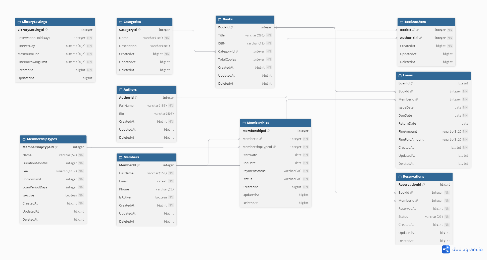

# Library Management System

A Blazor Server app for a librarian to manage books, members, memberships, loans,
fines and reservations. Built with .NET 8, EF Core 8 (code-first) and PostgreSQL.

## Tech stack

- .NET 8 / C# / Blazor Server (Interactive Server render mode)
- Bootstrap 5.3.3 + Bootstrap Icons (both self-hosted), with a small custom theme in `wwwroot/app.css`
- Entity Framework Core 8 with Npgsql provider, code-first migrations
- PostgreSQL (administered through pgAdmin)
- xUnit + Microsoft.NET.Test.Sdk (business-rule unit tests; Playwright E2E is optional future work)

## Setup

### 1. Prerequisites

- .NET 8 SDK
- PostgreSQL with pgAdmin
- EF CLI tools:

```powershell
dotnet tool install --global dotnet-ef --version 8.*
```

### 2. Create the database

In pgAdmin, create an empty database named `LibraryManagementDB`. The connection
details (host, port, database, user) are in `appsettings.json`; the **password is
intentionally not stored in the repo**.

### 3. Set the password via user-secrets

Run from the project folder, replacing the password with your own:

```powershell
dotnet user-secrets set "ConnectionStrings:DefaultConnection" `
  "Host=localhost;Port=5432;Database=LibraryManagementDB;Username=postgres;Password=YOUR_PASSWORD"
```

User-secrets override `appsettings.json` on your machine only, so nothing
sensitive is committed.

### 4. Apply the migrations

```powershell
dotnet ef database update
```

This creates the `citext` extension, all tables, constraints, indexes and seed
data. The three migrations are `InitialCreate`, `SoftDeleteAll` and
`RemoveLibrarySettingDeletedAt`.

### 5. Run

```powershell
dotnet run
```

Open the app and sign in with:

| Username | Password |
|---|---|
| `librarian` | `library@123` |

Credentials are fixed in `FixedLibrarianCredentialStore` for this demo — there
is no user table and no ASP.NET Core Identity.

Fine amounts, limits and the reservation hold window are seeded automatically and
can be changed from **Settings** in the sidebar; no pgAdmin edits are needed.

## Features

| Area | Pages | Notes |
|---|---|---|
| Auth | `/login` | Cookie auth, persists across refresh, signed-in users are redirected away from `/login` |
| Dashboard | `/` | Live counts for books, categories, members, authors, active memberships, loans, overdue loans and pending reservations |
| Categories | `/categories` | Full CRUD, duplicate-name check |
| Authors | `/authors` | Full CRUD, duplicate-name check |
| Books | `/books` | Full CRUD, category dropdown, multi-author selection, manages `BookAuthors` rows, shows available/total copies |
| Members | `/members` | Full CRUD, unique email (`citext`), auto Regular plan, plan/loans/fine visible in the list |
| Membership types | `/membership-types` | Full CRUD, plan limits and pricing |
| Memberships | `/memberships` | Full CRUD, one live plan per member, Free/Paid display, Active/History tabs, Renew only when no other plan is live, Upgrade only to a higher plan |
| Upgrade | `/memberships/upgrade/{memberId}` | Higher-plan only; single option is auto-selected; old row is expired, new row starts today |
| Loans | `/loans` | Active/History tabs, issue/return, plan-based auto due date, real available-copy counts in the dropdown, specific validation failures, automatic late-fine calculation |
| Reservations | `/reservations` | Full CRUD, always starts as Pending, one pending per member/book, auto-expiry from settings, oldest-first Fulfil issues the loan and marks the reservation Fulfilled in one transaction |
| Settings | `/settings` | Edit the single config row (fines, limits, reservation hold) without pgAdmin |
| Demo API | `/api/categories` | Read-only JSON endpoint |

All list views use soft delete with inline confirmation, search, optional filters,
page-size selection and pagination. All forms use DataAnnotations validation plus
friendly duplicate/error messages.

## Project structure

```
Data/
  LibraryDbContext.cs      Model config, relationships, constraints, filters, seed data
  UnixTimeConverters.cs    DateTime <-> Unix seconds value converters
Models/                    Entity classes with DataAnnotations
Models/Dtos/               Input, output and form-data DTOs per feature
Services/                  I*Service / *Service pairs per feature, plus auth,
                           settings, dashboard and shared ServiceHelpers
                           (IDbContextFactory-based, fresh context per operation)
Components/
  Pages/                   One Razor page per feature
  Shared/                  ListPageBase + ListToolbar (search/filter/tabs/paging)
  Layout/                  MainLayout and NavMenu
  App.razor, Routes.razor  Root, cascading auth, router
wwwroot/app.css            Custom theme (sidebar, cards, forms, login, responsive)
Migrations/                EF Core migrations
docs/
  LibraryManagementSystem.dbml   ER diagram source for dbdiagram.io
  er-diagram.png                 Exported ER diagram
```

## ER diagram



## Design decisions and assumptions

| Topic | Decision |
|---|---|
| **Unix time** | Every `DateTime`/`DateTime?` is stored as a `bigint` of Unix seconds via EF value converters applied model-wide in `ConfigureConventions`. C# keeps normal `DateTime`; reads return UTC. |
| **Date-only values** | `IssueDate`, `DueDate`, `ReturnDate`, `StartDate`, `EndDate` are `DateOnly` and remain SQL `date`. |
| **Validation** | `[Required]`, `[MaxLength]`, `[EmailAddress]`, `[Range]` live on models/DTOs. Fluent API is used only for relational concerns: relationships, indexes, check constraints, precision, defaults, filters. |
| **Soft delete** | Every business table has `DeletedAt` plus a global query filter. Nothing is ever hard-deleted. Soft-deleted rows keep their history; partial unique indexes release names/emails for reuse. `LibrarySettings` is the deliberate exception: it is one editable config row with no delete flow, so it has no `DeletedAt`. |
| **Auth flow** | Login is a plain HTML form POST to `/account/login`, so the cookie is written to the browser response. `UseAuthentication()`/`UseAuthorization()` populate `HttpContext.User`; `PersistentComponentState` carries the identity into interactive circuits. |
| **BookAuthors** | EF never creates these automatically. `BookService` inserts a row per selected author; on edit it soft-deletes removed links and **revives** re-added ones (composite PK `(BookId, AuthorId)` cannot be duplicated). |
| **Fine payment** | `FinePaidAmount` allows partial payment; fully paid when `FinePaidAmount == FineAmount`. |
| **Borrow block** | Unpaid fines are summed with `.IgnoreQueryFilters()` so all history counts; borrowing is blocked only when the total **exceeds** `FineBorrowingLimit` (exactly the limit still allows borrowing). |
| **ISBN** | Unique among live books via a partial unique index. |
| **Settings** | `LibrarySetting` is a single-row config table (seeded with Id = 1), editable at `/settings`. It drives fines, the borrowing fine limit and reservation hold expiry. It is never deleted, so it has no `DeletedAt` column or query filter. |
| **DbContext lifetime** | Services use `IDbContextFactory<LibraryDbContext>` and a fresh context per operation. This removes the "second operation started on this context" error in Blazor circuits. The scoped registration remains only for EF tooling. |
| **Free plan** | A plan with `Fee = 0` is always stored as `PaymentStatus = Paid` and displayed as **Free**. Payment status is disabled on the form for these plans. |
| **Auto Regular plan** | Creating a member also creates an active Regular membership (12 months, Paid) in the same transaction. No separate step is needed before borrowing. |
| **Plan lifecycle** | Saving a membership with `Status = Active` but an `EndDate` in the past stores it as Expired. Upgrade marks the current plan Expired and starts a new Active row today (higher fee only). Renew clones an ended plan from today and is only offered when the member has no other live plan. A date-based refresh runs on the Members/Memberships/Loan-create pages: `EndDate < today` becomes Expired and a member with no live plan becomes Inactive. |
| **Email storage** | PostgreSQL `citext` gives case-insensitive uniqueness. Creating the extension may require sufficient privileges locally. |
| **Name uniqueness** | Duplicate name checks in the services are literal case-insensitive comparisons (`lower(Name) = lower(input)`), so `%` and `_` are treated as normal characters. The DB indexes for names are still case-sensitive, so the app check is the authoritative guard. |
| **Failed saves** | A `DbUpdateException` (e.g. a unique-index race) is converted to `false` and the failed entity is detached, so a circuit's long-lived DbContext is not poisoned. |
| **Filtered lookups** | Update/delete methods query by key instead of `FindAsync`, so soft-deleted rows are never revived or edited accidentally. Dependency checks use `IgnoreQueryFilters()` with an explicit `DeletedAt == null` on the dependent row. |

## Business rule map

| Rule | Where it is enforced |
|---|---|
| BR-01 Borrow limit | `LoanIssueHelper` uses `MembershipType.BorrowLimit` inside the issue transaction |
| BR-02 Copy available | `LoanIssueHelper`: `TotalCopies - open loans`, with `SELECT ... FOR UPDATE` on the book row |
| BR-03 Loan period | `LoanIssueHelper` requires the due date to fall within `MembershipType.LoanPeriodDays`; the create form auto-fills it from the member's plan (14 days Regular / 21 Premium), capped at membership end date |
| BR-04 Late fine, capped | `LoanService.UpdateAsync` uses `FinePerDay` and `MaximumFine` inside the return transaction; a non-zero fine on the form is treated as a manual override |
| BR-05 Fine block | `LoanIssueHelper` unpaid-fine sum vs `FineBorrowingLimit` (all history counts); blocks only when the sum is **greater than** the limit |
| BR-06 Same book twice | Explicit pre-check returns a named-book error, backed by the unique filtered index on `(BookId, MemberId)` where `ReturnDate IS NULL`; returning a loan cannot be undone |
| BR-07 FCFS reservations | Reservations only for 0-copy books; `FulfillAsync` refuses a newer row while an older Pending row exists (ordered by `ReservedAt`, then `ReservationId`) |
| BR-08 Transactions | Issue and return each use one explicit transaction (validation reads + write + commit). `FulfillAsync` shares one context/transaction for the loan insert and reservation update; book/member create and plan upgrade also use explicit transactions |
| BR-09 Delete rules | Soft-delete filters + service guards against deleting referenced rows; `LibrarySettings` has no delete path and no `DeletedAt` |
| BR-10 Auto free plan | `MemberService.CreateAsync` creates an active Paid Regular membership with the member |
| BR-11 Upgrade / renew | `MembershipService.UpgradeAsync` / `RenewAsync`; upgrade requires a higher fee, renew requires no other live plan, history is preserved as new rows |
| BR-12 Expiry | `RefreshExpiriesAsync` expires ended plans and deactivates members with no live plan; loans also require cover through the due date |
| BR-13 Reservation hold | `ReservationService.ExpireOldReservationsAsync` uses `ReservationHoldDays` from Settings |
| BR-14 Auto due date | `LoanService.GetBorrowInfoAsync` + loan form set due date from `LoanPeriodDays`, capped at membership end date |

## Unit testing (xUnit)

The decisions that do not need a database were extracted from the services into
pure helpers under `Services/Policies`. The real services call these same helpers,
so a passing test means the app uses the tested decision, not a copy of it.

| Rule | Test file | What it proves |
|---|---|---|
| BR-01, BR-02, BR-05, BR-06 | `LibraryManagementSystem.Tests/BorrowRulesTests.cs` | 3/5-book limits, free-copy arithmetic, exactly ₹100 allowed, duplicate open-loan detection |
| BR-03 | `LibraryManagementSystem.Tests/LoanDatePolicyTests.cs` | 14/21-day periods including the exact last valid day, and membership-end cap |
| BR-04 | `LibraryManagementSystem.Tests/FineCalculatorTests.cs` | ₹5/day, ₹200 cap, manual override, unchanged-date behaviour and fine-paid validation |
| BR-07 | `LibraryManagementSystem.Tests/ReservationQueuePolicyTests.cs` | `ReservedAt` FCFS ordering with `ReservationId` tie-break |
| Unix seconds convention | `LibraryManagementSystem.Tests/UnixTimeConverterTests.cs` | Known timestamps, UTC round-trip and `Unspecified`-as-UTC handling |

Current result: **48 tests, 0 failures**.

BR-08 (transactions/row locks) and BR-09 (soft-delete guards) are deliberately
not claimed as unit tests: they need a real PostgreSQL integration test or a
Playwright end-to-end test to prove database behaviour. EF InMemory cannot prove
transactions, `FOR UPDATE` locks or filtered unique indexes.

## Useful commands

```powershell
dotnet build
dotnet run

dotnet ef migrations add <Name>
dotnet ef migrations remove
dotnet ef database update
dotnet ef dbcontext script   # verify the generated SQL model

dotnet test                  # run all 48 xUnit tests (stop the app first)
dotnet test -c EfCheck       # works even while the Blazor app is running
dotnet test --logger "console;verbosity=detailed"
# npx playwright test        # optional future end-to-end stage
```

## Known limitations / planned work

- Fulfilling a reservation runs the same borrowing checks as the Issue Book form, in the same transaction; if a rule fails, the reason is shown and the reservation stays Pending. An older Pending reservation for the same book must be fulfilled, cancelled or expired first.
- The free Regular plan is looked up by the exact name `Regular`, and upgrades/renewals rely on seeded plan data. Renaming/deleting that plan disables automatic assignment.
- The ER diagram is in `docs/er-diagram.png` and its DBML source is in `docs/LibraryManagementSystem.dbml`.
- Playwright end-to-end tests are not part of this phase; they can be added later if browser-level verification is required.
- UI is intentionally simple; no high-level design framework is used.
- Name uniqueness (category/author/membership type) and "one active membership" are enforced in services, not by case-insensitive/partial unique DB indexes. A future migration can harden this.
- The interactive circuit caches the authenticated principal at prerender; signing out in another tab only takes effect after a page reload.
- Antiforgery tokens are not attached to the plain login/logout form POSTs (local demo only).
